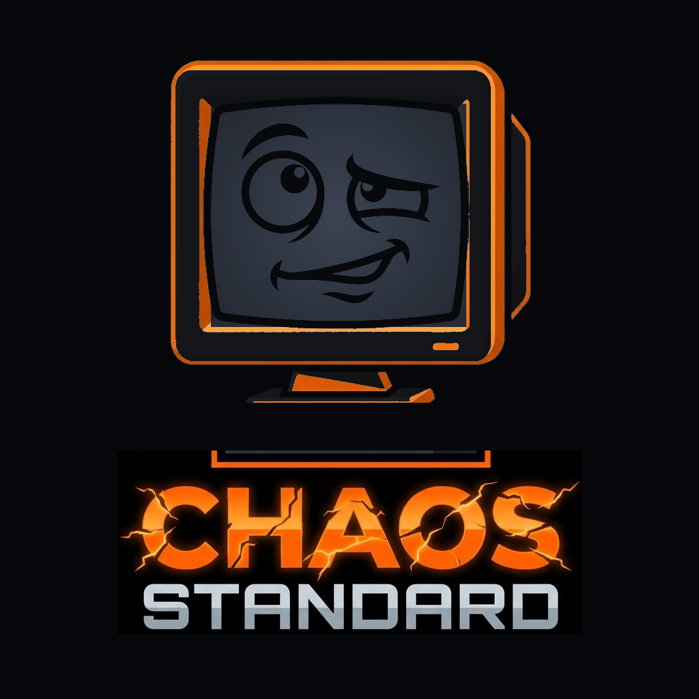

# Chaos Standard // Official Studio Website

<p align="center">
  <a href="https://chaosstandard.com">
    
  </a>
</p>

> **"We take making ridiculous things extremely seriously."**  
> Official Website: [https://chaosstandard.com](https://chaosstandard.com)  
> GitHub Repository: [https://github.com/Caanundrum/Chaos_Standard_Home](https://github.com/Caanundrum/Chaos_Standard_Home)

---

## 1. About Chaos Standard

**Chaos Standard** is an independent game studio building original, browser-native game experiences. We believe the web browser is the most expressive, accessible, and criminally underutilized gaming platform on earth.

### Core Studio Hallmarks
- **Museum-Grade Visuals:** High-fidelity graphics, atmospheric lighting, and architectural typography.
- **Unconventional Mechanics:** Rule systems designed for delightful emergence and surprising outcomes.
- **Controlled Chaos & 4th-Wall Breaking:** Interfaces with personality, games that notice you, and clever humor.
- **Zero Friction:** Pure browser experiences with zero installation, instant load times, and effortless multiplayer sharing.

---

## 2. The Game Catalog

### Game 1: Hallucinated Dungeons
*Tabletop RPG Soul × Generative Fantasy Intelligence*  
An ambitious AI-driven multiplayer fantasy role-playing experience inspired by classic pen-and-paper games. The bespoke AI Dungeon Master tracks deep world memory, authors dynamic encounters, and responds to player agency without ever feeling like a generic chatbot.  
- **Status:** Alpha 3 Staging Playable
- **Live Staging URL:** [https://hd.chaosstandard.com](https://hd.chaosstandard.com)
- **Genre:** AI Multiplayer Tabletop RPG
- **Platform:** Browser-Native (Zero Install)

### Game 2: Do Not Press Submit
*The Antagonistic User Interface Experience*  
A humorous, interactive browser game where the interface itself becomes part of the experience. The player is confronted with simple instructions and an increasingly questionable relationship with the software.  
- **Status:** Prototype Preview Available
- **Live Development Preview:** [https://dnps.chaosstandard.com](https://dnps.chaosstandard.com)
- **Platform:** Browser-Native

### Game 3: Project [REDACTED]
*Next-Generation Browser Experiment*  
Our laboratory is actively incubating unannounced browser titles exploring unconventional physics and ludonarrative insolence.  
- **Status:** Classified / In Development

---

## 3. The Studio Identity & Master Logo Suite

The official Chaos Standard brand identity centers on the **"Bewildered Terminal" (Chaos Monitor)**: a symmetrical retro-futuristic CRT computer monitor that has witnessed too much procedural reality distortion.

Perched over the fractured, electric-charged **CHAOS** wordmark and the precision brushed sci-fi **STANDARD** block lettering, the monitor features:
- **Clean Symmetrical Silhouette:** Pure frontal CRT chassis with clean stand (zero rear 3D protrusion, zero clutter).
- **Zero-White Phosphor Screen:** Slate grey CRT display (`#1E222A`) with expressive, bewildered line art, raised eyebrow, and crooked smirk.
- **Strict Color Architecture:** High-contrast palette locked to **Hazard Orange (`#FF6A00`)**, **CRT Slate Phosphor (`#1E222A`)**, **Standard Slate (`#94A3B8`)**, and deep obsidian **Pitch Black (`#05070A`)**.

### Master Reusable Asset Suite (`public/brand/`)

| Asset | File | Format / Ratio | Description & Use Case |
| :--- | :--- | :--- | :--- |
| **Master Lockup (Hi-Res)** | [`chaos-logo-master.png`](public/brand/chaos-logo-master.png) | PNG / 1:1 (1024×1024) | Primary studio lockup on pitch-black canvas for store headers, press releases, and media. |
| **Master Lockup (Alpha Transparent)** | [`chaos-logo-transparent.png`](public/brand/chaos-logo-transparent.png) | PNG / 1:1 (1024×1024) | Transparent cutout for game titles, stream overlays, light/dark hero headers, and box art. |
| **Master Lockup (JPG)** | [`chaos-logo-master.jpg`](public/brand/chaos-logo-master.jpg) | JPG / 1:1 (1024×1024) | Solid black background format for Discord, social avatars, and web headers. |
| **Bewildered Terminal Mark** | [`chaos-mark-symbol.png`](public/brand/chaos-mark-symbol.png) | PNG / 1:1 (512×512) | Standalone mascot symbol: monitor chassis, orange bevel, and expressive slate face. |
| **Terminal Mark (JPG)** | [`chaos-mark-symbol.jpg`](public/brand/chaos-mark-symbol.jpg) | JPG / 1:1 (512×512) | Standalone symbol on solid black for app icons and square profiles. |
| **Wordmark Lockup** | [`chaos-wordmark.png`](public/brand/chaos-wordmark.png) | PNG / 5:2 | Isolated typographic lockup: fractured orange CHAOS + sci-fi brushed STANDARD. |
| **Cinematic Splash Card** | [`chaos-splash-card.png`](public/brand/chaos-splash-card.png) | PNG / 16:9 (1920×1080) | 1080p widescreen presentation card for boot sequences, video title cards, and game intros. |
| **Splash Card (JPG)** | [`chaos-splash-card.jpg`](public/brand/chaos-splash-card.jpg) | JPG / 16:9 (1920×1080) | Open-Graph social preview card and high-speed web cover. |
| **Micro Glyph / Favicon** | [`favicon.png`](public/favicon.png) | PNG / 1:1 | Pixel-tuned micro symbol optimized for 16px to 64px browser tabs and home screen bookmarks. |

For complete design guidelines, token values, and rules, see [BRAND_GUIDE.md](BRAND_GUIDE.md).

---

## 4. Key Interactive Features

- **Continuous CRT Logo Reveal:** High-impact electron-beam expansion & CRT monitor unzipping sequence (`StudioSplashReveal.tsx`) with procedural synthesized audio and instant skip option.
- **The Chaos Calibrator:** Real-time HUD entropy slider (0% to 100%) that alters site physics, background turbulence, particle velocity (up to 10x dynamic range), and terminal telemetry.
- **Dynamic Constellation Particles:** Restrained, non-distracting HTML5 canvas particle engine with dynamic amber/orange/slate constellation lines that link nearby floating particles.
- **The "Do Not Click" Challenge:** Antagonistic 5-stage interactive challenge in the hero banner that dares players and leads directly to *Do Not Press Submit*.
- **Tabletop DM Oracle Simulator:** Embedded in the *Hallucinated Dungeons* showcase; roll the d20 for real-time generative DM narration.
- **Antagonistic UI Test Field:** Embedded in the *Do Not Press Submit* showcase; an evasive button that taunts your cursor and rewards defiance with confetti.
- **Decryption Telemetry Tuner:** Embedded in the *Project [REDACTED]* showcase; frequency slider that reveals classified development clues.
- **Interactive Developer CLI (`~`):** Slide-out command console supporting `status`, `games`, `dungeon`, `submit`, `chaos`, and easter eggs.
- **Procedural Web Audio Engine:** Pure zero-dependency synthesizer powering haptic clicks, chimes, and rumble without external audio files.
- **Brand Assets & Media Kit Modal:** Integrated download center for hi-res PNGs, transparent cutouts, color token copier, and live splash simulator.

---

## 5. Technology Stack

- **Framework:** React 19 + TypeScript
- **Bundler:** Vite
- **Styling:** Tailwind CSS v4 with custom atmospheric layers
- **Icons:** Lucide React
- **Audio:** Web Audio API (procedural synthesis)
- **Effects:** HTML5 Canvas Particle Engine & `canvas-confetti`
- **Hosting Target:** Firebase Hosting (Static SPA)

---

## 6. Local Development

### Prerequisites
- Node.js (v18+)
- npm (v9+)

### Installation
```bash
git clone https://github.com/Caanundrum/Chaos_Standard_Home.git
cd Chaos_Standard_Home
npm install
```

### Run Local Development Server
```bash
npm run dev
```
Open `http://localhost:5173` in your browser.

### Production Build
```bash
npm run build
```
Generates production-optimized static files in `/dist`.

### Preview Production Build
```bash
npm run preview
```

---

## 7. Firebase Hosting Deployment

The project is pre-configured with `firebase.json` for static hosting:

```bash
# 1. Install Firebase CLI (if not already installed)
npm install -g firebase-tools

# 2. Login to Firebase
firebase login

# 3. Deploy static site
npm run build
firebase deploy --only hosting
```

---

## 8. License & Copyright

© 2026 Chaos Standard. All rights reserved.  
*"We take making ridiculous things extremely seriously."*
