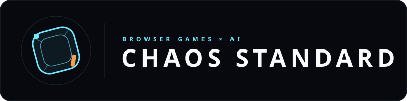

# Chaos Standard // Official Studio Website

[](https://chaosstandard.com)

> **"We take making ridiculous things extremely seriously."**  
> Official Website: [https://chaosstandard.com](https://chaosstandard.com)  
> GitHub Repository: [https://github.com/Caanundrum/Chaos_Standard_Home](https://github.com/Caanundrum/Chaos_Standard_Home)

---

## 1. About Chaos Standard

**Chaos Standard** is an independent game studio building original, browser-native game experiences. We believe the web browser is the most expressive, accessible, and criminally underutilized gaming platform on earth.

### Core Studio Hallmarks
- **Museum-Grade Visuals:** High-fidelity graphics, atmospheric lighting, and architectural typography.
- **Unconventional Mechanics:** Rule systems designed for delightful emergence and surprising outcomes.
- **Controlled Chaos & 4th-Wall Breaking:** Interfaces with personality, games that notice you, and clever humor.
- **Zero Friction:** Pure browser experiences with zero installation, instant load times, and effortless multiplayer sharing.

---

## 2. The Game Catalog

### Game 1: Hallucinated Dungeons
*Tabletop RPG Soul × Generative Fantasy Intelligence*  
An ambitious AI-driven multiplayer fantasy role-playing experience inspired by classic pen-and-paper games. The bespoke AI Dungeon Master tracks deep world memory, authors dynamic encounters, and responds to player agency without ever feeling like a generic chatbot.  
- **Status:** Alpha 3 Staging Playable
- **Live Staging URL:** [https://hd-a3-player--hd-a3-staging.us-central1.hosted.app/](https://hd-a3-player--hd-a3-staging.us-central1.hosted.app/)
- **Genre:** AI Multiplayer Tabletop RPG
- **Platform:** Browser-Native (Zero Install)

### Game 2: Do Not Press Submit
*The Antagonistic User Interface Experience*  
A humorous, interactive browser game where the interface itself becomes part of the experience. The player is confronted with simple instructions and an increasingly questionable relationship with the software.  
- **Status:** Prototype Preview Available
- **Live Development Preview:** [https://donotpresssubmit--donotpresssubmit.us-central1.hosted.app/](https://donotpresssubmit--donotpresssubmit.us-central1.hosted.app/)
- **Platform:** Browser-Native

### Game 3: Project [REDACTED]
*Next-Generation Browser Experiment*  
Our laboratory is actively incubating unannounced browser titles exploring unconventional physics and ludonarrative insolence.  
- **Status:** Classified / In Development

---

## 3. The Studio Logo Family

The Chaos Standard brand identity centers on the **"Impossible Delta"**: a mathematically pure, non-Euclidean three-facet Penrose prism representing the collision of metric precision (*"Standard"*) with impossible reality-bending paradox (*"Chaos"*). It is bold, simple, and identifiable at a glance.

Reusable vector assets are provided in [`public/brand/`](public/brand/):

1. **`chaos-symbol-dark.svg`** — Primary Studio Emblem (Dark Mode)
2. **`chaos-symbol-light.svg`** — Inverted Studio Emblem (Light Mode)
3. **`chaos-logo-horizontal-dark.svg`** — Full Horizontal Studio Lockup (Dark)
4. **`chaos-logo-horizontal-light.svg`** — Full Horizontal Studio Lockup (Light)
5. **`chaos-logo-stacked-dark.svg`** — Vertical Poster / Box Art Lockup (Dark)
6. **`chaos-logo-stacked-light.svg`** — Vertical Poster / Box Art Lockup (Light)
7. **`chaos-mark-small.svg`** — Simplified 32px / 16px Micro Glyph (Favicon)
8. **`chaos-splash-card.svg`** — Official 16:9 **"A Chaos Standard Game"** Presentation Splash

For complete typography, color tokens, and design rules, see [BRAND_GUIDE.md](BRAND_GUIDE.md).

---

## 4. Key Interactive Features

- **Cinematic Studio Splash Reveal:** High-impact studio reveal sequence on entry with procedural audio and skip options.
- **The Chaos Calibrator:** Real-time HUD slider (0% to 100%) that dynamically adjusts site physics and microcopy.
- **Tabletop DM Oracle Simulator:** Embedded in the *Hallucinated Dungeons* showcase; roll the d20 for real-time generative DM narration.
- **Antagonistic UI Test Field:** Embedded in the *Do Not Press Submit* showcase; an evasive button that taunts your cursor and rewards defiance with confetti.
- **Decryption Telemetry Tuner:** Embedded in the *Project [REDACTED]* showcase; frequency slider that reveals classified development clues.
- **Interactive Developer CLI (`~`):** Slide-out command console supporting `status`, `games`, `dungeon`, `submit`, `chaos`, and easter eggs.
- **Procedural Web Audio Engine:** Pure zero-dependency synthesizer powering haptic clicks, chimes, and rumble without external MP3 files.
- **Brand Assets & Media Kit Modal:** Integrated vector download center, color token copier, and live splash simulator.

---

## 5. Technology Stack

- **Framework:** React 19 + TypeScript
- **Bundler:** Vite
- **Styling:** Tailwind CSS v4 with custom atmospheric layers
- **Icons:** Lucide React
- **Audio:** Web Audio API (procedural synthesis)
- **Effects:** HTML5 Canvas Particle Engine & `canvas-confetti`
- **Hosting Target:** Firebase Hosting (Static SPA)

---

## 6. Local Development

### Prerequisites
- Node.js (v18+)
- npm (v9+)

### Installation
```bash
git clone https://github.com/Caanundrum/Chaos_Standard_Home.git
cd Chaos_Standard_Home
npm install
```

### Run Local Development Server
```bash
npm run dev
```
Open `http://localhost:5173` in your browser.

### Production Build
```bash
npm run build
```
Generates production-optimized static files in `/dist`.

### Preview Production Build
```bash
npm run preview
```

---

## 7. Firebase Hosting Deployment

The project is pre-configured with `firebase.json` for static hosting:

```bash
# 1. Install Firebase CLI (if not already installed)
npm install -g firebase-tools

# 2. Login to Firebase
firebase login

# 3. Deploy static site
npm run build
firebase deploy --only hosting
```

---

## 8. License & Copyright

© 2025 Chaos Standard. All rights reserved.  
*"We take making ridiculous things extremely seriously."*
